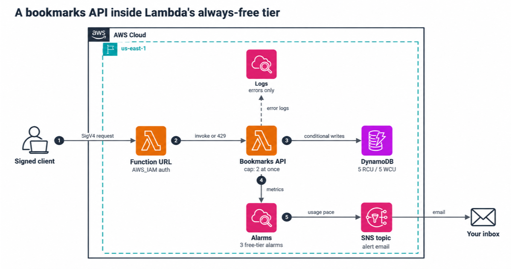

# A bookmarks API inside Lambda's always-free tier

This repo is a small bookmarks API on an AWS Lambda function URL, with Amazon DynamoDB for storage. It's built to cost $0 a month within the always-free allowances, and to have a known worst-case bill if traffic goes wrong.

It's written in AWS CDK (TypeScript). The tests run the real bundle against DynamoDB Local, and `npm run free-tier-model` works out how many requests a month stay free from measured duration and memory.

## Architecture



## What it does

Callers sign every request with AWS Signature Version 4 (SigV4). Lambda checks the signature before the function runs, then passes the caller's IAM identity to the handler. Each caller sees only their own bookmarks.

| Route | What happens |
|---|---|
| `POST /bookmarks` | Creates a bookmark from `{ url, title?, tags? }`. Returns 201 and `ETag: "1"` |
| `GET /bookmarks?limit=20&after=<id>` | Lists your bookmarks, newest first. `next` is the cursor for the next page |
| `GET /bookmarks/<id>` | Reads one bookmark, with its version in the `ETag` header |
| `PUT /bookmarks/<id>` | Replaces it. Needs `If-Match: "<version>"`. A stale version gets 412 |
| `DELETE /bookmarks/<id>` | Deletes it. `If-Match` is optional. A missing bookmark gets 404 |

Every write is a DynamoDB conditional write. A create never overwrites, an update never brings back a deleted bookmark, and two clients editing the same version can't both win.

## What keeps it at $0

| Piece | Setting | Why |
|---|---|---|
| Front door | Lambda function URL, `AWS_IAM` auth | No extra charge for the URL itself. Strangers get 403 |
| Function | Node.js 24, arm64, 256 MB, 5 s timeout | A request bills a few milliseconds. The 1M free requests run out long before the 400,000 free GB-seconds |
| Cost ceiling | Reserved concurrency 2 | At most 2 copies run at once, and the URL accepts at most 20 requests a second. Worst month: $23.04 |
| Alarms | Requests per day, GB-seconds per day, throttles | 3 of the 10 free alarm metrics, none of them metric math |
| Table | Provisioned, 5 read and 5 write units, no auto scaling | The always-free DynamoDB capacity is for provisioned tables only |
| Logs | JSON, 1-week retention, system log level WARN | A successful request writes no log bytes |

[docs/cost.md](docs/cost.md) shows the math and the sources.

## Deploy

You need Node.js 24, AWS credentials, and a CDK-bootstrapped account.

```bash
npm ci
npm run check                                     # type check, lint, tests, synth with cdk-nag
npm run deploy -- -c alertEmail=you@example.com
```

The stack prints `Url`. Confirm the email subscription so the alarms reach you. Then run the smoke test with the same credentials:

```bash
npm run smoke
```

It checks that an unsigned request gets 403, runs create, read, update and delete with signed requests, and sends a burst of 60 calls to confirm the reserved concurrency cap returns 429.

To let another IAM role call the API, deploy with `-c invokerArn=arn:aws:iam::<account>:role/<name>`. CDK grants it both permissions a function URL needs.

### Settings

| Context value | Default | What it changes |
|---|---|---|
| `reservedConcurrency` | 2 | The cap on parallel copies, and so on the bill |
| `memorySize` | 256 | Memory in MB. The compute alarm adjusts to it |
| `monthlyRequestBudget` | 1000000 | This API's share of the account's free requests |
| `monthlyGbSecondBudget` | 400000 | This API's share of the free GB-seconds |
| `reportLines` | false | `true` logs Lambda's START and REPORT lines, for measuring |

New AWS accounts start with a lower Lambda concurrency quota, and Lambda keeps 100 units unreserved. If the deploy fails on reserved concurrency, the steps to check and raise your quota are in [docs/runbook.md](docs/runbook.md), under the deploy section.

## Measure, then model

```bash
docker run -d --rm -p 8012:8000 amazon/dynamodb-local:3.3.2
AWS_ENDPOINT_URL_DYNAMODB=http://localhost:8012 npm run measure
npm run free-tier-model
```

`measure` runs the bundled handler 1,000 rounds against DynamoDB Local, one request at a time like a Lambda environment. It records the mean billed duration (each request rounded up to the next millisecond), peak memory, log bytes and response sizes in `measurements.json`.

`free-tier-model` turns those numbers into free requests a month, the bill past the free tier, and the worst case under reserved concurrency. Laptop numbers are a floor. After a deploy, pass real ones:

```bash
npm run free-tier-model -- --duration-ms 18 --memory-mb 256
```

## Tests

| Command | What runs | Needs |
|---|---|---|
| `npm test` | Unit tests, model tests, CDK template tests, cdk-nag, bundle checks | Nothing |
| `npm run test:int` | The real bundle against DynamoDB Local, including races | Docker |
| `npm run smoke` | Checks against your deployed stack | A deploy |

The integration tests send 20 updates of the same version at once and expect one winner and 19 refusals. They also check that 10 parallel deletes give one 204, that an update never brings back a deleted bookmark, and that one caller can't touch another's data. Each safeguard was broken on purpose once to confirm a test fails.

## More docs

- [docs/cost.md](docs/cost.md): the free-tier math and the cost ceiling
- [docs/security.md](docs/security.md): auth, isolation between callers, and what we left out
- [docs/runbook.md](docs/runbook.md): what to do when an alarm fires

## Clean up

```bash
npm run destroy
```

The stack keeps the bookmarks table on purpose. Delete it in the DynamoDB console when you're sure.

---

Created by Rahul Ladumor / InfraTales, under the MIT-0 license
